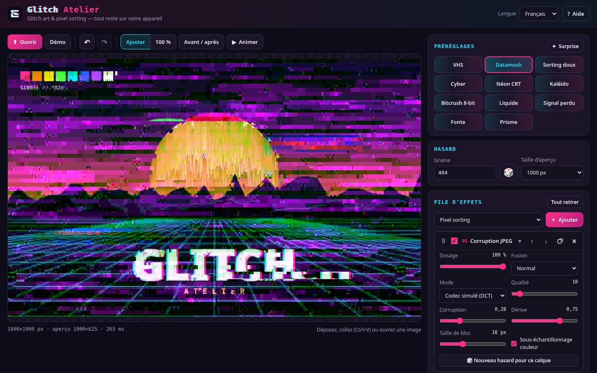
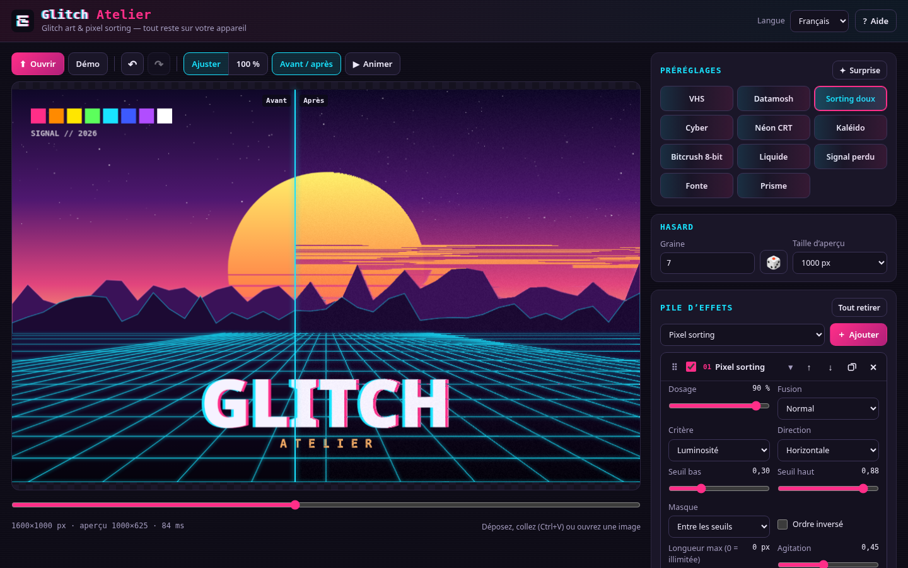
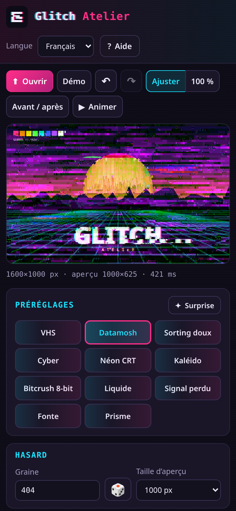
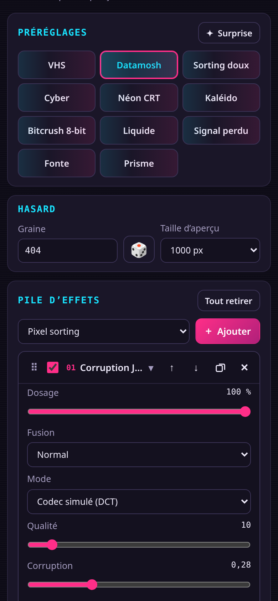

# Glitch Atelier

Studio libre de **glitch art** et de **pixel sorting** pour graphistes, monteurs vidéo et artistes numériques.
Tout tourne dans le navigateur : **aucune image n’est envoyée sur un serveur**, pas d’installation, pas de compte.

**Démo en ligne :** [https://salimadour31-boop.github.io/glitch-atelier/](https://salimadour31-boop.github.io/glitch-atelier/)



| Comparateur avant / après | Mobile | Mobile — pile d’effets |
|---|---|---|
|  |  |  |

---

## Fonctionnalités

- **Image** : ouvrir un fichier, glisser-déposer, coller (<kbd>Ctrl</kbd>+<kbd>V</kbd>), ou utiliser l’image de démo générée par le code (aucune photo externe).
- **Pile d’effets non destructive** : ajouter, supprimer, dupliquer, réordonner (glisser, boutons ↑/↓ ou <kbd>Alt</kbd>+<kbd>↑</kbd>/<kbd>↓</kbd>), activer / désactiver chaque calque, avec **dosage** et **mode de fusion** (normal, écran, produit, différence, addition, éclaircir, assombrir, incrustation).
- **13 effets**, écrits de zéro :
  1. **Pixel sorting** — tri par luminosité, teinte, saturation ou canal R/V/B ; horizontal, vertical ou angle libre ; masque par seuils bas / haut (entre ou hors des seuils), ordre inversé, longueur max, agitation aléatoire.
  2. **Décalage RVB** — offsets X/Y indépendants par canal, ordre des canaux (RGB, GBR…), bouclage aux bords.
  3. **Aberration chromatique** radiale — centre, intensité, progression.
  4. **Tranches & blocs** — déplacement de tranches ou de blocs rectangulaires (graine), parfois sur un seul canal.
  5. **Corruption JPEG** — *codec simulé* (DCT par blocs, YCbCr, sous-échantillonnage, quantification, coefficients corrompus, dérive du DC, blocs répétés) ou *vrais octets JPEG* (l’image est réellement encodée, des octets du flux sont altérés puis décodés, avec repli automatique sur le codec simulé).
  6. **Bandes VHS** — bandes de tracking qui défilent, tremblement des lignes, bruit de tête, bavure couleur, désaturation, bruit de bande.
  7. **Écran CRT** — courbure, lignes de balayage qui suivent la courbure, masque RVB, vignettage, luminosité, scintillement.
  8. **Onde** — sinus, carré, dent de scie, triangle ; axe X / Y / les deux ; séparation RVB par phase.
  9. **Pixelisation / mosaïque** — taille, proportion, moyenne ou centre, grille façon LED.
  10. **Postérisation / bit-crush** — niveaux, tramage ordonné, bits supprimés, masque XOR.
  11. **Bruit / grain** — couleur ou monochrome, taille du grain, lignes parasites.
  12. **Miroir / kaléidoscope** — gauche↔droite, haut↔bas, quatre quarts, kaléidoscope (2–24 segments), tuiles miroir.
  13. **Fonte / coulure** — colonnes de pixels qui coulent vers le bas ou le haut.
- **Hasard reproductible** : une **graine** globale + un hasard propre à chaque calque ; bouton 🎲 pour relancer. Même graine + mêmes réglages = même image, en aperçu comme en export.
- **11 préréglages originaux** : VHS, Datamosh, Sorting doux, Cyber, Néon CRT, Kaléido, Bitcrush 8-bit, Liquide, Signal perdu, Fonte, Prisme — et un bouton **Surprise** (pile aléatoire).
- **Fluide** : le calcul se fait dans un **Web Worker** (repli automatique sur le fil principal si le fichier est ouvert en local) ; aperçu en taille réduite (640 / 1000 / 1400 px), **rendu pleine résolution à l’export**.
- **Comparateur avant / après** (curseur ou glisser sur l’image), maintien de <kbd>B</kbd> pour voir l’original, **annuler / rétablir**, zoom **Ajuster / 100 %**, **aperçu animé**.
- **Exports** : **PNG** pleine résolution, **JPG** (qualité réglable), **boucle vidéo WebM** (1–8 s, 12/24/30 i/s, 480–1280 px, hasard animé ; message clair si le navigateur ne sait pas enregistrer), **réglages JSON** (export / import), **lien de partage** qui contient la pile d’effets dans l’URL (`#g=…`, jamais l’image).
- **Interface** en **français** (par défaut), **anglais** et **taqbaylit** (kabyle, latin) avec affichage optionnel en **tifinagh** ; langue mémorisée.
- Responsive (ordinateur et mobile ~375 px), utilisable au clavier, thème sombre original. 100 % HTML / CSS / JavaScript, sans build, sans dépendance, sans CDN.

## Utilisation

1. Ouvrez la [démo](https://salimadour31-boop.github.io/glitch-atelier/) — ou clonez le dépôt et ouvrez `index.html` (ou servez le dossier : `python3 -m http.server`).
2. Chargez une image ou gardez l’image de démo.
3. Cliquez sur un préréglage, puis ajustez les calques : dosage, fusion, réglages, ordre.
4. Changez la graine pour d’autres variantes ; activez *Avant / après* pour comparer.
5. Exportez en PNG / JPG (pleine résolution) ou enregistrez une boucle WebM ; gardez vos réglages en JSON ou partagez le lien.

## Raccourcis clavier

| Touche | Action |
|---|---|
| <kbd>Ctrl</kbd>+<kbd>Z</kbd> / <kbd>Ctrl</kbd>+<kbd>Y</kbd> (ou <kbd>Ctrl</kbd>+<kbd>Maj</kbd>+<kbd>Z</kbd>) | Annuler / rétablir |
| <kbd>R</kbd> | Nouvelle graine |
| <kbd>S</kbd> | Pile surprise |
| <kbd>P</kbd> | Animer l’aperçu |
| <kbd>C</kbd> | Comparateur avant / après |
| <kbd>B</kbd> (maintenir) | Voir l’original |
| <kbd>F</kbd> / <kbd>1</kbd> | Ajuster / 100 % |
| <kbd>O</kbd> | Ouvrir une image |
| <kbd>Ctrl</kbd>+<kbd>S</kbd> | Exporter le PNG |
| <kbd>Alt</kbd>+<kbd>↑</kbd> / <kbd>↓</kbd> | Déplacer le calque sélectionné |
| <kbd>?</kbd> | Aide |

## Confidentialité

Vos images restent sur votre appareil : elles sont lues et traitées localement par le navigateur (canvas + Web Worker). Rien n’est téléversé, aucune statistique, aucun cookie. Seules la langue et la taille d’aperçu sont gardées dans le `localStorage`. Le lien de partage et le fichier JSON ne contiennent que la pile d’effets et la graine.

## Structure

```
glitch-atelier/
  index.html
  css/style.css
  js/effects.js   ← moteur : 13 effets, fusion, rendu, JSON / URL (fonctionne aussi dans Node)
  js/worker.js    ← Web Worker de rendu
  js/presets.js   ← préréglages
  js/i18n.js      ← textes FR / EN / Taqbaylit + translittération tifinagh
  js/app.js       ← interface
  icons/icon.svg
  tests/          ← tests du moteur (Node) et de l’interface (Playwright)
```

## Tests

```
npm install            # installe Playwright (uniquement pour les tests d’interface)
npm test               # tests du moteur + tests d’interface (ordinateur 1440×900 et mobile 390×844)
```

Les tests vérifient notamment : chaque effet modifie l’image et reste déterministe, chaque option se calcule, les préréglages, le changement de langue, l’export PNG pleine résolution / JPG / WebM, l’aller-retour JSON et la restauration depuis l’URL (pixels identiques), l’absence d’erreur console.

## Licence

[MIT](LICENSE) — © 2026 Amirouche Amwanes / [salimadour31-boop](https://github.com/salimadour31-boop). Code, interface, logo et image de démo originaux.

---

## English

**Glitch Atelier** is a free, browser-only glitch-art and pixel-sorting studio. Load an image (file, drag & drop, paste) or use the procedurally drawn demo, then build a **non-destructive effect stack** — each layer with its own amount and blend mode, reorderable and toggleable. **13 effects** written from scratch: pixel sorting (brightness / hue / saturation / channel, horizontal / vertical / any angle, low–high threshold mask), RGB split, chromatic aberration, slice & block displacement, JPEG corruption (simulated block-DCT codec or real JPEG byte corruption with safe fallback), VHS tracking bands, CRT screen, wave distortion, pixelate / mosaic, posterize / bit-crush, colour noise / grain, mirror / kaleidoscope / tiles and melt / drip.

Randomness is **seeded** (reproducible), with 11 original presets and a *Surprise* button. Rendering runs in a **Web Worker**; the preview is reduced and exports are re-rendered at **full resolution**. Before/after slider, undo/redo, fit / 100 % zoom, animated preview. Export **PNG**, **JPG**, a looping **WebM** video (MediaRecorder), **settings JSON**, or a **share link** holding the stack (never the image). UI in French (default), English and Taqbaylit with optional Tifinagh. Images never leave your device. MIT licence.

**Demo:** https://salimadour31-boop.github.io/glitch-atelier/

## Taqbaylit

**Glitch Atelier** d ahil ilelli n glitch art d usmizzwer n yipiksilen deg yiminig : 13 n yisemdan, aɛeqqa, asifeḍ PNG / JPG / WebM — tugniwin-ik ur ffɣent ara seg yibenk-ik.
